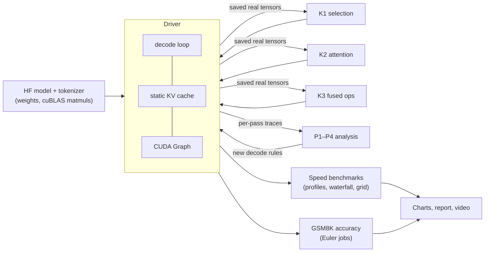

# The Project, Explained

This is the walkthrough for anyone on the team who is new to how LLMs run. It assumes you know C++, CUDA and Python. It does not assume you know anything about language models. Read it top to bottom once; after that, [PLAN.md](PLAN.md) has the exact numbers and decisions, and [explainer.html](explainer.html) has the pictures (download it and open it in a browser).

**Labels you will see everywhere:**
- **K1, K2, K3** are the three CUDA kernels we write: K1 parallel selection, K2 block-causal attention, K3 fused small ops (section 6.2).
- **P1–P4** are the four new decoding strategies: P1 stop on time, P2 merge the commit pass, P3 two steps per pass, P4 smarter commit rules (section 7).
- **τ (tau)** is the confidence threshold (section 4).

---

## 1. The project in one paragraph

There is a new kind of language model, a **diffusion LLM (dLLM)**, that writes several words per step instead of one. On a laptop GPU that should make it faster than a normal LLM, because a laptop GPU spends most of its time waiting on memory, and a dLLM gets more words out of each wait. In practice it isn't faster yet, because the software that runs it wastes a lot of time. We are building a better engine for it on top of PyTorch, writing our own CUDA kernels for the parts that only dLLMs need, and then checking whether the dLLM actually beats the best normal-LLM engine (llama.cpp) on speed, and what it costs in accuracy.

---

## 2. How a language model writes text

A language model works on **tokens**: pieces of text, usually a word or part of one. "Janet's ducks lay 16 eggs" is about 8 tokens. The model's vocabulary has 151,936 possible tokens.

The model itself is a big function with about 1.5 billion fixed numbers in it, called **weights** (about 3 GB in bf16). You hand it a sequence of tokens, it runs them through 28 identical **layers**, and at the end it outputs, for each position, a score for every one of the 151,936 vocabulary tokens (the **logits**). Turn those scores into probabilities and pick the most likely token. Running the model once like this is a **forward pass**.

A normal model is **autoregressive (AR)**: it writes one token per forward pass. To write a 250-token answer, it runs 250 forward passes, each time appending the new token and asking "what comes next?"

Inside each layer, two kinds of work happen:
- **Matrix multiplies** with the weights. This is almost all of the arithmetic.
- **Attention**, where each position looks back at earlier positions. To avoid recomputing the past every time, the model saves two vectors per token per layer, called **K and V**, in the **KV cache**. Each new pass reads the cache instead of redoing the old tokens.

## 3. Why it's slow on a laptop: memory, not math

Here is the key fact for the whole project. **Every forward pass has to read all 3 GB of weights from GPU memory.** The RTX 4060 Laptop reads memory at about 256 GB/s, so one pass can never take less than about **12 ms**, no matter how fast the arithmetic is.

When you generate one token per pass, the arithmetic is tiny compared with that 3 GB read, so the GPU's math units sit idle most of the time. The GPU is **memory-bound**. That caps a normal model at about 75–80 tokens per second on this laptop. llama.cpp, the best engine there is for this, reaches 64.6.

We measured what happens if you push more tokens through one pass. Processing 32 tokens takes 1.06× as long as processing 1. Processing 64 takes 1.08×. Only past about 128 does it start to cost real time. **On this GPU, handling up to ~64 tokens per pass is essentially free**, because you are paying for the weight read either way.

That free capacity is the whole opportunity.

## 4. The diffusion idea: guess many tokens at once

Our dLLM is **Fast-dLLM v2** from NVIDIA. It is the same Qwen2.5-1.5B model, retrained a little so it can fill in blanks. It writes in **blocks of 32 tokens**:

1. A new block starts as 32 slots: the first one known, the other 31 blank (a special **MASK** token).
2. The model runs one forward pass over the whole block and predicts a token for every blank slot, each with a **confidence** (its probability).
3. Every blank whose confidence is above a **threshold τ** (tau, e.g. 0.9) gets **committed**: its guess is kept. The single most confident blank is always committed, so each pass makes progress.
4. Repeat on the blanks that are left. The block is worked on in four groups of 8 slots, left to right.
5. When the block is full, one more pass (the **commit pass**) writes the block's K/V into the cache, and the next block begins.

Inside a block, positions can see each other in both directions. Across blocks, a block can only see the blocks before it. That rule (**block-causal attention**) is what lets finished blocks go into the KV cache unchanged.

If the model commits 2 tokens per pass on average, it writes about twice as fast as a normal model, because each pass still costs about the same 12 ms. The threshold is a dial:
- High τ: commit only very confident guesses. Fewer tokens per pass, slower, more accurate.
- Low τ: commit more aggressively. Faster, but more wrong guesses.
- τ = 1 means one token per pass, the same speed profile as a normal model.

In our October pilot at τ = 0.9, the model committed about 1.7–2.1 tokens per pass on math problems and about 1.2 on open-ended prose.

## 5. The catch: the reference software wastes the advantage

NVIDIA's own code for this model takes **22 ms per pass**, not 12. We profiled it:

| Where the 22 ms goes | Time |
|---|---|
| Reading weights for the matrix multiplies (the unavoidable part) | ~11.6 ms |
| Everything else on the GPU, spread over ~1,364 tiny kernel launches | ~4.2 ms |
| The GPU sitting idle while Python on the CPU issues the next kernel | ~6.5 ms |

The code is written for clarity, not speed. Every pass it:
- builds an attention mask on the CPU and copies it to the GPU
- copies the entire KV cache with `torch.cat` in every layer, then duplicates it 6× (`repeat_kv`) before attention
- computes a full softmax over all 151,936 vocabulary entries for 32 positions, even though only 8 are used
- stops 5+ times to ask the GPU a yes/no question, which forces the CPU to wait for the GPU to drain

So the dLLM at 22 ms per pass and ~1.7 tokens per pass ends up at 78 tok/s on math, barely above llama.cpp's 64.6, and *slower* than llama.cpp on prose. The model has the advantage; the software throws it away.

## 6. What we are building

We are **not** rewriting the model from scratch. The TAs told us that would eat the whole project, and they were right. Hugging Face loads the weights and the tokenizer, and cuBLAS does every matrix multiply. (Our measurements show cuBLAS is already at the memory limit for these shapes, so there is nothing to win by replacing it.)

We write the parts that are specific to diffusion decoding. There are two layers to it.

### 6.1 The driver

The **driver** is the Python program that runs generation. It is the loop from section 4: build the block, run a pass, pick the tokens to commit, repeat, commit the block, start the next. It also owns the KV cache. Ours differs from NVIDIA's in three ways that matter:

- **A static KV cache.** One buffer allocated up front, written in place. No `torch.cat`, no reallocation, every tensor shape fixed.
- **A CUDA Graph.** Because shapes are fixed, we can record one entire forward pass (all ~1,400 kernel launches) once, then replay it with a single launch. That removes most of the 6.5 ms of CPU idle time.
- **Swappable ops.** Each operation in the pass can run either the stock PyTorch version or ours, behind a switch. We start with all stock ops (stage 1) to prove the static cache and graph work, then swap in our kernels one at a time, and check each against the version it replaces.

The same driver also runs the normal model (Qwen2.5-1.5B-Instruct) as a block size of 1. That gives us an AR engine built exactly like our dLLM engine, which we compare with llama.cpp to show our engine is genuinely fast.

### 6.2 The kernels

Each kernel replaces a cluster of slow PyTorch operations with one CUDA kernel. You don't need to understand the model to write them: each has a precise input, a precise output, a PyTorch version to check against, and real input tensors saved from the model to test on.

**K1, parallel selection.** Input: the logits for the current block positions (up to 32 rows × 151,936 columns), the mask of which slots are still blank, τ. Output: the updated tokens, the updated mask, and a "block done?" / "end of text?" flag.
- For each row, find the largest logit (that's the guess) and the sum of exp(logit − max). Then the guess's probability is 1 / that sum, with no full softmax needed.
- Then apply τ, force-commit the single most confident blank, and write the tokens.
- This is a big parallel reduction plus a small decision step, entirely on the GPU, with no CPU round trip.

**K2, block-causal attention.** Input: the queries for the block's positions, the KV cache, its current length. Output: the attention result.
- It reads the static cache in place, so there is no copy.
- Each K/V head is shared by 6 query heads, so one load serves all 6, removing the 6× duplication.
- The mask is applied by index arithmetic, so no mask tensor exists.
- At batch size 1 there are only 2 K/V heads, too few to fill the GPU, so the work is split along the length of the cache and the partial results are combined at the end.
- It handles 1 query row (AR mode), 32 (one block) or 64 (two blocks at once, for section 7).

**K3, fused small ops.** Three short kernels that each merge several PyTorch ops into one launch:
- RMSNorm plus the residual add
- the rotary position encoding (RoPE) plus the write into the KV cache
- SiLU × multiply in the MLP

Small individually, but they account for most of the ~1,400 launches per pass.

For every kernel we report how fast it is on its own (and how close it gets to the GPU's memory bandwidth) and how much it takes off the full pass.

## 7. Doing better than the standard recipe

Section 3 said a pass over 64 tokens costs about the same as a pass over 32. The standard recipe doesn't use that. These ideas do:

- **P1, stop on time.** Stop as soon as the end-of-text token is committed, instead of finishing the block and running an extra commit pass. Easy, saves a few percent.
- **P2, merge the commit pass into the next block's first pass.** One 64-row pass instead of two 32-row passes. The catch: the next block's first token normally comes *out* of the commit pass, so we have to guess it from the previous pass and check the guess afterwards. Worth building only if the guess is usually right.
- **P3, run two steps in one pass.** Guess what the block will look like after this step, and run "this step" and "the guessed next step" together in one 64-row pass. If the guess was right, we advanced two steps for the price of one; if not, we throw the second half away. Worth building only if guesses are right often enough (around 40% or more).
- **P4, smarter commit rules.** For example, commit a position early if its guess hasn't changed for two passes. This changes the output, so it has to be checked against accuracy.

For P2 and P3 we first **measure** how often the guesses would be right, using recorded traces of real generation. That measurement is a result in itself, whether or not we end up building the feature.

## 8. How we will know it worked

**Speed.** We measure ms per pass, tokens per pass and tokens per second, at batch size 1 (one user), for:
- the normal model on llama.cpp (the best AR engine there is)
- the normal model and the dLLM on the reference code
- both on our engine

The headline is our dLLM engine against llama.cpp. We also build an **ablation waterfall**: start from the reference, add one optimization at a time, and record ms per pass after each. That shows what each piece of work bought.

**Accuracy.** We use **GSM8K**, grade-school math word problems where the answer is a single number, so grading is automatic. We take 100 problems picked by a fixed random seed and run the normal model and the dLLM at several thresholds on the same 100. That gives a speed-versus-accuracy chart: how much accuracy each step of speed costs.

**Hardware.** Three GPUs:
- the RTX 4060 Laptop (the main target)
- an RTX 3090 (desktop, ~3.6× the memory bandwidth, so overheads matter more there)
- Euler's RTX 4000 SFF Ada (the same chip generation as the laptop at a similar bandwidth, so anyone can reproduce our results on it)

## 9. How the pieces fit together

The pieces of work, and what each one hands to the others:

| Piece | Produces | Needs from others |
|---|---|---|
| **Driver** | the engine; saved real tensors for kernel testing; per-pass traces; the op switch the kernels plug into | nothing to start (stage 1 uses stock ops) |
| **K1 / K2 / K3** | drop-in CUDA ops with tests and microbenchmarks | the op signature and saved tensors (available early; until then, random tensors of the right shape) |
| **Decoding strategies (P1–P4)** | hit-rate analysis; new decode rules | traces from the driver (or from the reference code, which works today) |
| **Speed measurement** | profiles, the cuBLAS knee on each GPU, the waterfall, the final grid | the pilot scripts work today; later, the driver |
| **Accuracy on Euler** | GSM8K harness, the τ sweep, per-problem results | nothing to start (runs on the reference code); later, the driver |
| **Report and video** | the final story | results from all of the above |

Every piece can start right away. Kernels test on saved or random tensors, accuracy and measurement run on the reference code, and strategy analysis uses traces from the reference code. The seams (the op signatures, the saved-tensor format, the trace format, the results format, the Euler job template) get pinned down before anyone writes much code, so nobody waits on anybody.

## 10. Timeline

| When | What |
|---|---|
| 11/17–11/23 | Profile the reference; driver stage 1; kernels against saved tensors; GSM8K harness and the reference τ sweep; traces and hit rates |
| 11/24–11/30 | Kernels inside the driver; waterfall; AR mode; P1, P2; P3 if the hit rate allows |
| 12/1–12/2 | Final benchmark runs; results frozen |
| 12/3–12/4 | Slides; record the video |
| 12/5–12/7 | Report |

## 11. Words you will see

| Term | Meaning |
|---|---|
| **Token** | A piece of text, roughly a word. The vocabulary has 151,936. |
| **Weights** | The model's fixed numbers (~1.5 B, ~3 GB). Read once per forward pass. |
| **Forward pass / pass / step** | One run of the model over its input. The unit of cost here (~12 ms minimum on the laptop). |
| **Logits** | The model's score for every vocabulary token at each position. |
| **AR (autoregressive)** | One token per pass. How normal LLMs work. |
| **dLLM / block diffusion** | Fills a 32-token block of blanks over several passes, several tokens per pass. |
| **MASK** | The "blank" token in a block. |
| **Threshold τ** | Confidence needed to commit a guess. Higher is slower and more accurate. |
| **Commit** | Keep a guessed token permanently. |
| **Tokens per pass** | The dLLM's speed multiplier. AR is always 1. |
| **KV cache** | Saved per-token K and V vectors for every layer, so past tokens aren't recomputed. |
| **Block-causal** | Positions see their own block in both directions and earlier blocks only. |
| **GQA (grouped-query attention)** | 12 query heads share 2 K/V heads (6 each). |
| **Memory-bound** | Time is set by bytes read, not by arithmetic. True for us at batch size 1. |
| **cuBLAS** | NVIDIA's matrix-multiply library. We use it; we don't compete with it. |
| **Kernel** | One function launched on the GPU. |
| **CUDA Graph** | A recording of many kernel launches, replayed with one launch. Removes CPU launch overhead. |
| **Driver** | Our program that runs the decode loop, owns the cache and replays the graph. |
| **Ablation waterfall** | Performance after adding each optimization in turn, so each one's effect is visible. |
| **GSM8K** | Grade-school math word problems with a single numeric answer. Our accuracy test. |
| **llama.cpp** | The best existing engine for normal LLMs on consumer hardware. Our AR baseline. |

## 12. Where to read more

- [PLAN.md](PLAN.md): exact numbers, decisions and risks.
- [research/pilot-measurements.md](research/pilot-measurements.md): everything we measured in October.
- [research/fastdllm-v2-survey.md](research/fastdllm-v2-survey.md): the reference code, line by line, and related papers.
- [Fast-dLLM v2 paper](https://arxiv.org/abs/2509.26328) and [code](https://github.com/NVlabs/Fast-dLLM).
