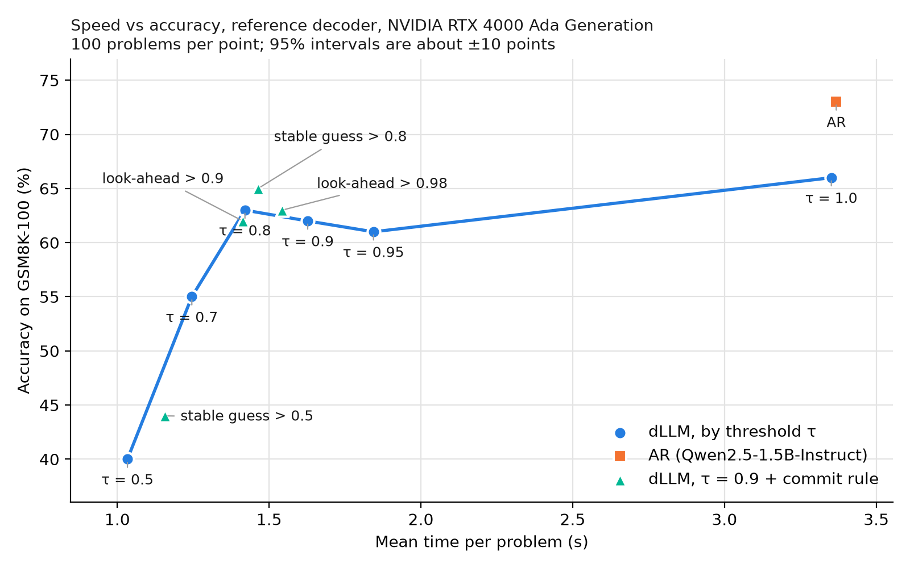

# Accuracy: parallel decoding is nearly free down to τ = 0.8; the dLLM itself trails AR by 7 to 14 points

The dLLM answers 66% of GSM8K-100 at τ = 1.0 against 73% for the AR model (65% against 79% after a hand audit of the grades). Lowering τ to 0.8 cuts decode time 2.4× while accuracy stays at 63%. Below τ = 0.8 accuracy falls: 55% at τ = 0.7 and 40% at τ = 0.5. The accuracy cost of this system sits in the model; the threshold buys speed almost for free until 0.8.

## Setup

**Dataset.** GSM8K-100 is a fixed sample of 100 GSM8K test problems (`eval/gsm8k_100.jsonl`, seed 759). Every setting runs the same 100 problems, so each comparison is paired.

**Models and decoder.** The dLLM is Fast-dLLM v2 1.5B with block 32 and sub-block 8; the AR baseline is Qwen2.5-1.5B-Instruct with greedy decoding. Both run through `dllm/reference_decode.py` at batch size 1 with a 512-token budget and the same user prompt.

**Metrics.** Accuracy is the share of problems whose extracted number equals the gold answer, with a 95% Wilson interval. For each pair of settings we count the problems only one of them solves and apply McNemar's exact test. Speed is wall-clock time per problem after one untimed warm-up.

**Hardware.** All eleven runs use the NVIDIA RTX 4000 Ada on Euler. Euler mixes this card with the slower RTX 4000 SFF Ada under one Slurm label, so we reran every job that landed on the SFF card. `eval/analyze.py` produces the tables and the chart from `results/gsm8k/` and refuses to mix GPU models.

## AR scores above the dLLM at every threshold

| Setting | Accuracy (95% interval) | Passes per problem | Tokens per pass | Seconds per problem | Only setting right / only AR right | McNemar p vs AR |
|---|---|---|---|---|---|---|
| AR | 73% (64–81) | 245 | 1.00 | 3.37 | | |
| dLLM τ = 1.0 | 66% (56–75) | 219 | 1.00 | 3.35 | 10 / 17 | 0.248 |
| dLLM τ = 0.95 | 61% (51–70) | 117 | 1.84 | 1.84 | 7 / 19 | 0.029 |
| dLLM τ = 0.9 | 62% (52–71) | 104 | 2.06 | 1.63 | 8 / 19 | 0.052 |
| dLLM τ = 0.8 | 63% (53–72) | 89 | 2.39 | 1.42 | 7 / 17 | 0.064 |
| dLLM τ = 0.7 | 55% (45–64) | 78 | 2.74 | 1.25 | 6 / 24 | 0.001 |
| dLLM τ = 0.5 | 40% (31–50) | 65 | 3.30 | 1.03 | 4 / 37 | < 0.001 |

AR solves 7 to 33 more problems than the dLLM. Under the automatic grades the paired test separates the two at τ = 0.95, 0.7 and 0.5, and stops short at τ = 1.0, 0.9 and 0.8 (p = 0.25, 0.05 and 0.06).

**Adjusted after hand corrections.** The table below repeats the comparison after we read the answers and corrected eleven grades by hand. These numbers are our reading of the saved texts; the table above and every results file keep the automatic grades.

| Setting | Automatic | Grades corrected | Adjusted accuracy (95% interval) | Only setting right / only AR right | McNemar p vs AR |
|---|---|---|---|---|---|
| AR | 73% | +6 | 79% (70–86) | | |
| dLLM τ = 1.0 | 66% | −1 | 65% (55–74) | 8 / 22 | 0.016 |
| dLLM τ = 0.95 | 61% | −1 | 60% (50–69) | 5 / 24 | < 0.001 |
| dLLM τ = 0.9 | 62% | −1 | 61% (51–70) | 6 / 24 | 0.001 |
| dLLM τ = 0.8 | 63% | +1, −1 | 63% (53–72) | 6 / 22 | 0.004 |
| dLLM τ = 0.7 | 55% | none | 55% (45–64) | 5 / 29 | < 0.001 |
| dLLM τ = 0.5 | 40% | none | 40% (31–50) | 3 / 42 | < 0.001 |

The grader marks seven correct answers wrong: six from AR (`gsm8k-0052`, `0151`, `0187`, `0595`, `0909`, `1059`) and one from the dLLM at τ = 0.8 (`gsm8k-0595`). These answers end in a sentence such as "Adam will be 38 years old in 8 years", put the number before the marker, or write the marker where the number belongs ("$####.00"). The grader also credits one looping dLLM answer (`gsm8k-0726`) at τ = 1.0, 0.95, 0.9 and 0.8. After the corrections AR leads by 14 to 39 points, and the paired test separates the two at every threshold (p ≤ 0.016).

**Takeaway.** The dLLM is the less accurate model on GSM8K at batch size 1, however conservatively it decodes.

## Lowering τ to 0.8 cuts decode time 2.4× at no measurable accuracy cost

The figure plots time per problem against accuracy; the blue line connects the dLLM settings in τ order. From τ = 1.0 to τ = 0.8 the line is flat: accuracy moves from 66% to 63% while time falls from 3.35 s to 1.42 s. The paired test finds no difference between τ = 0.8 and τ = 1.0 (5 vs 8 discordant problems, p = 0.58; 5 vs 7 and p = 0.77 on the adjusted grades). The line breaks below 0.8: τ = 0.7 loses 13 problems and gains 2 against τ = 1.0 (p = 0.007).

Time per problem tracks pass count. A dLLM pass over 32 positions costs 15.3–15.9 ms in the reference decoder, against 13.8 ms for an AR pass over one token, so the speedup comes from committing 2.4 tokens per pass.

**Takeaway.** τ = 0.8 dominates the paper's default of τ = 0.9 here: 14% fewer passes at the same accuracy. Every engine speedup multiplies this curve and leaves the accuracy axis unchanged.

## P2 clears its bar at both thresholds; P3 clears it only at τ = 0.9

Per-pass traces of 30 problems give the hit rates that decide the engine's speculative passes (`docs/report/hit-rates.md`). The guess of the next block's first token is right in 92.6% of commit passes at τ = 0.9 and 91.7% at τ = 0.7, above P2's 70% bar. The best P3 rule predicts the next pass's commits exactly in 47.3% of applicable passes at τ = 0.9 and 35.5% at τ = 0.7, against a 40% bar.

**Takeaway.** We recommend building P2, and P3 only for τ = 0.9 with the single-slot rule.

## The P4 commit rules land on the τ curve

| Rule added to τ = 0.9 | Accuracy | Passes per problem | Only rule right / only τ = 0.9 right | McNemar p |
|---|---|---|---|---|
| None (plain τ = 0.9) | 62% | 104 | | |
| Look-ahead > 0.98 | 63% | 99 (−5%) | 3 / 2 | 1.000 |
| Look-ahead > 0.9 | 62% | 89 (−14%) | 5 / 5 | 1.000 |
| Stable guess > 0.8 | 65% | 94 (−10%) | 5 / 2 | 0.453 |
| Stable guess > 0.5 | 44% | 76 (−27%) | 4 / 22 | < 0.001 |

*Look-ahead* also commits slots beyond the current 8-slot window above a second confidence threshold. *Stable guess* also commits a window slot whose guess repeats the previous pass's guess above a lower threshold. Three of the four settings remove 5–14% of passes without a measurable accuracy change; stable guess at 0.5 removes 27% and loses 18 points.

**Takeaway.** The rules reproduce the trade that τ already offers: look-ahead at 0.9 reaches 89 passes and 62%, and plain τ = 0.8 reaches 89 passes and 63%. Lowering τ gives the engine the same saving with no new code path.

## The engine accuracy check is pending

The reference runs store the token IDs of every answer. Once the engine's driver runs our kernels, we rerun AR and τ = 0.9 with `--engine ours` and compare those token IDs per problem.

## Limits

- **Sample size.** One accuracy carries about ±10 points; the paired counts support the claims above.
- **Answer format.** AR writes the requested `####` marker in 23 of 100 answers and the dLLM in 49–61, so the grader often falls back to the last number in the text. The grader follows the spec's rule exactly, so a number written before the marker ("Final answer: 15####") counts as no answer. The audit read, in all seven settings, every wrong answer that contains the gold number and every right answer that ends without an answer phrase. Where a boxed number and the number after `####` disagree, the audit keeps the number after the marker.
- **Timing scope.** Times come from the reference decoder, where framework overhead dominates each pass. They rank the settings; the engine's times replace them in the final grid.
